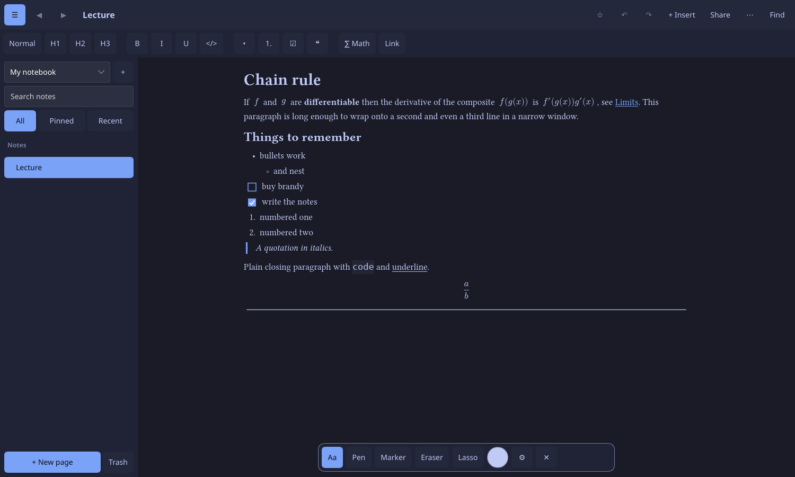

# Scrawl

A calm note-taking app in pure Rust + [Slint](https://slint.dev), good at handwriting and handwritten math.
Type like in a word processor, or write and draw with a mouse, trackpad, pen tablet or a phone/tablet; Scrawl can turn
handwriting into text or typeset math in place. Linux and Windows. No Chromium, no webview.

> **Status: the page is now one document.** Type like in a word processor and draw or write by hand on the same
> page. See [`docs/ui-redesign.md`](docs/ui-redesign.md) for the design and [`CHANGELOG.md`](CHANGELOG.md). Some items
> are still open (see `HANDOFF.md`); Windows builds are CI-tested but not hand-tested.



## What works today

- **Obsidian-style linking:** `[[wiki links]]` with suggestions, backlinks, a graph of linked notes, `#tags`, Markdown
  vault export and import ([`docs/obsidian.md`](docs/obsidian.md)).
- **Plugins:** sandboxed WebAssembly plugins (write them in Rust) and no-code snippet packs
  ([`docs/plugins.md`](docs/plugins.md)).
- Ink canvas: pen, highlighter, eraser, smoothing, scribble-to-delete, undo/redo, zoom/pan, paper backgrounds.
- Recognition: 191 classes (digits, Latin, Greek, operators, relations, calculus, sets/logic, arrows, blackboard bold...),
  90.5 % top-1 / 99.5 % top-5 on the HASYv2 test split, under 1 ms per symbol on CPU, 2.9 MB model.
- Candidate strip (keys 1-5), automatic personal training from corrections, "Train my handwriting" mode.
- Expression tree -> Typst / LaTeX / Unicode; spatial parsing of scripts, fractions, roots, sums, integrals.
- Notes: pages in a notebook with templates, autosave + crash recovery, full-text search, export to
  PDF/PNG/Markdown/Typst/LaTeX/HTML.
- **Graph view** (Desmos-style): type `y = a sin(x)`, `x^2 + y^2 = 4`, `y > x - 3`, `(cos(t), sin(t))`,
  points and `a = 2`; parameters become sliders; zeros, extrema and intersections are listed.
- **MATLAB**: run a script subset (`linspace`, `.*`, matrices, `plot`, `title`...) and import `.mat` data files,
  all in Rust. No control flow, functions or toolboxes.
- Typing mode (Type button): shorthand like `alpha`, `->`, `sqrt`, `mat3x3`, `a/b`, `x^2` with live Typst rendering.
- Tablet panel: connect, pair by QR code, approve, revoke (see SECURITY.md).
- Library crates: typing shorthand + autocomplete + template editor, storage (Typst + JSON, atomic, trash,
  history, backups, encryption), search, export (PDF/PNG/MD/Typst/LaTeX/HTML), plotter, PDF import,
  Opus audio, tablet server.

## Install

Download from the GitHub release page: a Linux AppImage, a Windows portable zip, or a Windows installer.
Verify with `SHA256SUMS`. Nothing else to install; no GPU needed.

## Build

```bash
cargo build --release -p scrawl
./target/release/scrawl              # run
./target/release/scrawl --self-test  # headless smoke test (exit 0 = OK)
```

Linux build dependencies (Arch): `pacman -S alsa-lib fontconfig libxkbcommon wayland dbus pkgconf`.
Debian/Ubuntu: `libasound2-dev libfontconfig1-dev libxkbcommon-dev libwayland-dev libdbus-1-dev pkg-config`.

## Model training (optional; end users never need this)

Training is also pure Rust (`burn`) and runs on any GPU through Vulkan/DX12 (AMD, NVIDIA, Intel incl.
integrated) or on the CPU:

```bash
cargo run --release -p scrawl-train -- download
cargo run --release -p scrawl-train -- train --epochs 30
cp training/out/symbols.onnx training/out/labels.json crates/recog/model/
```

Details in [`training/README.md`](training/README.md). To adapt to *your* handwriting you do not need to
retrain: use the in-app **Train** button and draw each symbol a few times.

## Tablet as a drawing tablet

Off by default. Click "Connect tablet" (UI wiring in progress; library in `crates/remote`), install the
local CA once on the device, scan the QR code, compare the 6-digit code, approve. Full design, threat
model and reset instructions: [`SECURITY.md`](SECURITY.md).

## Data and attribution

- **HASYv2** (Martin Thoma, 2017), <https://zenodo.org/records/259444>, licensed under the Open
  Database License (ODbL) v1.0. Used for training the recognizer; attribution required, share-alike applies to
  the database itself. Commercial use is permitted.
- Synthetic training data is rendered from DejaVu and Libertinus fonts (free licenses). No non-commercial
  datasets are used.
- Typst (Apache-2.0), Slint (see their licensing terms), tract, burn, tantivy, rustls, rcgen, age, hayro,
  opus-pure and other crates under permissive licenses; see `Cargo.lock`.

## License

MIT. See [`LICENSE`](LICENSE).
